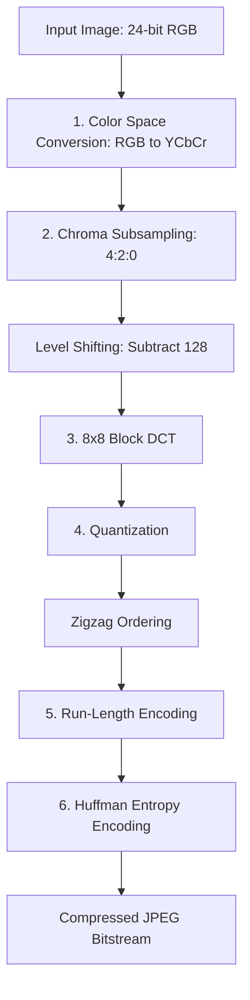

# JPEG_Compression_Algo

JPEG Compression Algorithm by scartch without using opencv.

Setup : 
```
git clone <repo_url>

python -m venv .venv

source .venv/bin/activate

pip install -r req.txt

```

Run Code : 

```
python JR_230415H_compress.py
```

Detailed methods included in the report in Docs.

Steps :


## JPEG Compression Pipeline

The JPEG compression process converts the RGB image into
YCbCr, reduces chrominance resolution, transforms image
blocks into frequency coefficients, and encodes the
quantized coefficients to produce a compressed bitstream.


